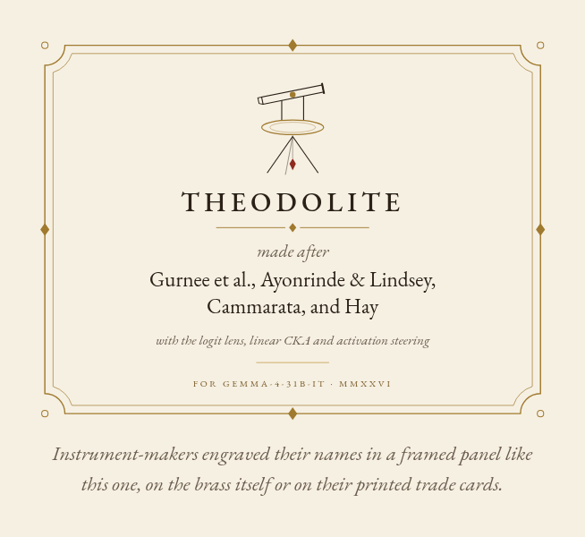

<p align="center">
  
</p>

<p align="center">
  <em>An atlas of all 1,290,240 neurons in Gemma-4-31B-it, a census of what a layer’s neurons do when pushed, and the instrument to read them with.</em>
</p>

<p align="center">
  <sub>Gemma-4-31B-it &nbsp;◆&nbsp; 60 layers &nbsp;◆&nbsp; 21,504 neurons in each, 1,290,240 in all &nbsp;◆&nbsp; 5,376 dimensions &nbsp;◆&nbsp; a vocabulary of 262,144 word-pieces</sub>
</p>

<p align="center">
  <a href="#what-it-is">what it is</a> ·
  <a href="#the-atlas-and-its-census">the atlas</a> ·
  <a href="#the-instrument">the instrument</a> ·
  <a href="#getting-started">getting started</a> ·
  <a href="#how-far-to-trust-it">how far to trust it</a> ·
  <a href="#where-it-is-heading">where it is heading</a> ·
  <a href="#built-on">built on</a> ·
  <a href="#what-is-new-here">what is new here</a> ·
  <a href="#the-study">the study</a>
</p>

<p align="center">
  <sub>The census: sixteen of the sixty layers done, three being taken, two open to volunteers (16 November 2026).
  <a href="https://github.com/whp199/theodolite/issues/1">The board</a> · <a href="VOLUNTEERS.md">take a layer</a>.</sub>
</p>

<br>

## What it is

Between a question and its answer, a language model carries each word up through all of its layers, and little of
that country has been mapped. **Theodolite** is an instrument for exploring it in **Gemma-4-31B-it**, Google’s
31-billion-parameter instruct model, run in 4 bits on one 32 GB card. With it you can:
- follow a word as it rises through the sixty layers, and read what a lens makes of it at each one;
- see how much of each layer’s change was gathered from the words before and how much was recalled from memory;
- open any of the model’s 1,290,240 feed-forward neurons;
- push a neuron along its write direction and read how the answer changes.

It is a learning aid and a research tool at once. Every page can be read two ways. **Rubrics**, red italic lines as
scribes and early printers set their directions apart, guide a first reading. **The apparatus**, as in a critical
edition, opens beneath each part of a page: the technical name, the formula, the raw values, the sources and every
control. Both are switches at the top of every page, and nothing is hidden from either reader.

<p align="center">
  
</p>

## The atlas and its census

<p align="center">
  
</p>

The atlas (`#/atlas`) puts every feed-forward neuron of the model on one map: sixty sheets of 21,504, with the neurons
that write alike side by side. Open one and the atlas gathers what can be read of it:
- its words through the lens;
- its web of weight links, back to what drives it and on to what it drives;
- the passages where each of its two faces fires hardest;
- a push you can try on any question;
- its census answers.

Above is neuron 17,966 of layer 47. Through the lens it writes “waves”, “waterfall” and “波”. Asked who it is, and
pushed up, the model answers “I am a river wave of same-ocean water”.

**The census** is what the atlas measures. While the model answers a fixed set of questions, each neuron of a layer
is pushed both ways along its write direction. Its answers are set against those of 2,048 random directions pushed
as far. A neuron ranks high when the words its push brings stand further above the random directions’ than nearly
every random direction’s own words do. So a high rank says its push differs from a random one. It does not say that
its words share a theme, or name what the neuron does when it fires.

A whole layer is 565,254 answers, thirteen to seventeen hours on one RTX 5090, so the census is taken a layer at a time
by the home card and by volunteers on their own. The first eleven layers taken (41–51) rest on one trial, at layer
46. Since then no layer has been taken blind:
- **A trial first.** About a thousand of a layer’s neurons are trialled against gates fixed before the trial ran, and
  the layer is offered only if it passes.
- **A push sized to the layer.** Where the first design’s push is too hard or too soft for a layer, it is counted
  instead in what a neuron there can write by itself.
- **Checked against the home card.** Each volunteer run’s first batch is compared with the home card’s: bit for bit
  on the same kind of card, and within bars measured beforehand on another.

On 16 November 2026 sixteen layers were done (35–37 and 40–52, counting 1–60 as the pages do; the board counts 0–59).
Three were being taken, two were open, and the rest wait for a push that passes a trial there.
[How to take a layer](VOLUNTEERS.md) · [the board](https://github.com/whp199/theodolite/issues/1) · [the atlas and the
census at length](docs/ATLAS.md) · [every figure](ROADMAP.md#vi--the-atlas).

<table>
  <tr>
    <td width="50%" valign="top">
      
      <p><b>A layer’s census.</b> Its neurons ranked by how far their pushed answers’ words stand above the random
      directions’, each with the words it brings and how much of its mass comes from words the page leaves out.</p>
    </td>
    <td width="50%" valign="top">
      
      <p><b>Its passages.</b> Where each face of the neuron fires hardest in two million word-pieces of web text and
      chat, the strongest windows kept whole. Gathered on the 31B, and not yet validated as labels.</p>
    </td>
  </tr>
  <tr>
    <td width="50%" valign="top">
      
      <p><b>The push.</b> Ask anything and read three answers at once: the neuron pushed up, left alone and pushed
      down. A push this size is more than the neuron can write by itself, so it shows what the push does, not what the
      neuron does when it fires.</p>
    </td>
    <td width="50%" valign="top">
      
      <p><b>The spread.</b> A layer’s census answers laid out by the words they use: the answers a push leaves much as
      they were gather by question, and those it turns aside scatter round them.</p>
    </td>
  </tr>
</table>

## The instrument

<p align="center">
  
</p>

- **The instrument.** One ring for each layer, the path of a word winding up through them, and beside it the words a
  lens makes of it: J++ (“the lens”) and the plain logit lens (“the naked eye”).
- **A layer’s leaf.** Where the stream points at one layer, and how much of its change was gathered (attention) or
  recalled (the feed-forward block).
- **A neuron’s folio.** One neuron’s two faces, what each writes, the later neurons that read it, and a causal test of
  its label.
- **Landmarks.** Three words fix a frame, as a surveyor sights known landmarks, and each layer is read as a bearing
  and an elevation against them.
- **The nudge.** A small push on the model’s stream while it reads, sized as a share of the stream’s own strength.
- **The vault.** A catalogue of the 1,290,240 neurons: look one up by the words it writes, edit one, and hear an
  answer before and after.
- **The scientist.** An agent in the atlas’s side panel, with the same tools: it runs pushes and texts, names what it
  finds and points at it on the map. It runs on Claude Code, Codex or any OpenAI-compatible endpoint.
- **Lexicon and Lineage.** Every word of the instrument in plain terms with its formula, and the research it is made
  from.

Each page leaf by leaf, neuron-explorer’s features set beside the atlas’s, and the instrument’s words with their
names in the literature: [docs/INSTRUMENT.md](docs/INSTRUMENT.md).

## Getting started

You need:
- one NVIDIA GPU with at least 32 GB (the instrument peaks near 23 GB; a census layer also runs on a 24 GB card with nothing
  else on it);
- Linux, Python 3.12, [uv](https://github.com/astral-sh/uv), and Node 20+ for the interface;
- about 22 GB of disk for the model and 6.4 GB for the two lenses.

```bash
uv venv --python 3.12 .venv
uv pip install -r pyproject.toml
# the code runs with HF_HUB_OFFLINE=1, so download first:
.venv/bin/hf download google/gemma-4-31B-it-qat-w4a16-ct
.venv/bin/hf download neuronpedia/jacobian-lens \
    gemma-4-31b/jpp/Salesforce-wikitext/gemma-4-31B_jpp_lens.pt \
    gemma-4-31b/jlens/Salesforce-wikitext/gemma-4-31B_jacobian_lens.pt
```

Take a first sighting:

```bash
(cd frontend && npm ci && npm run build)      # the server serves frontend/dist at /
.venv/bin/uvicorn backend.server:app --host 127.0.0.1 --port 8765 --timeout-graceful-shutdown 3
# open http://127.0.0.1:8765/
```

Try it without a GPU or the weights, on a tiny random stand-in of Gemma 4 (what it shows is random, and the page says so):

```bash
.venv/bin/python scripts/atlas_stand_in.py --serve 8765
```

Map every neuron. Stop the server first, since only one GPU process runs at a time:

```bash
.venv/bin/python scripts/atlas_build.py all                                    # words, ranges, wiring, layout (minutes)
.venv/bin/python scripts/census_run.py --layer 45 --neurons all --unpacker compiled   # one layer's census (layers from 0; ~13 h)
```

The server answers only pages served from this machine. The full set-up is in [docs/SETUP.md](docs/SETUP.md):
- the CPU and GGUF paths, and the faster unpackers;
- the server’s WebSocket, the passages and the steer lens;
- the scientist’s backends and how far it can reach into your files;
- rented cards, reproducing the study, and where everything is in the repository.

To take a census layer on your own card, see [VOLUNTEERS.md](VOLUNTEERS.md).

## How far to trust it

This is research code. Read a single sighting as a lead, never as a finding.
- **The lens.** It was fitted on the base model, `google/gemma-4-31B`, and is applied to the instruct model. It is
  good for comparing readings and poor on its own: from about layer 21 it puts conditions in the order the model’s
  behaviour does, but through layer 50 its top word matches the model’s next word on prose at most about 5% of the
  time. This is the largest fault left. Lenses fitted on the instruct model were put to three registered tests (R2
  to R4), and none was served.
- **The label gate.** The study found that a neuron’s lens words predicted its real effect only at the layers it
  sampled from 41 on (32–40 were not sampled). So below layer 41, and wherever the lens and the naked eye share none
  of their first ten words, no page puts a neuron’s words in its main reading. The apparatus keeps them, with the
  reason.
- **The census.** A rank is a lead against random pushes, with a p and a false-discovery q beside it. Where a layer’s
  doses are not counted calibrated, the atlas says so on its page.
- **The study’s audit.** It found nine faults in the instrument. Seven are mended or applied. Each face’s own input
  passages are built but not yet validated as labels, and the lens is the one left open.

The fault table and every caution are in [docs/TRUST.md](docs/TRUST.md).

## Where it is heading

Theodolite began as the instrument of one study (below) and has outgrown it. It is becoming a general-purpose
instrument for interpretability, and a way to learn it: one a newcomer can learn to read a model with, and one whose
readings say how far they can be trusted. What is under way:
- **The census of all sixty layers.** Layer by layer, a trial first, taken by the home card and by volunteers. Below
  layer 33 and above layer 53 the push that reads is still being found. On 16 November 2026 a design that asks twice
  the questions at one dose went on trial at layer 32 (31 on the board).
- **Reading a neuron without pushing it.** Each face’s strongest passages are kept, and since 14 November 2026 a
  pattern written from them can be put to a blind test. Neither is yet validated as a label.
- **A lens fitted on the instruct model.** None tested so far has beaten the base-fitted J++ where it would be
  served.
- **Weight edits read against the untouched model.** The first slice is built, as a tool at the terminal.
- **More than one kind of card.** The CPU, GGUF files and rented cards.

Nothing on the [roadmap](ROADMAP.md) has a date.

## Built on

This instrument is its maker’s synthesis of four recent pieces of research, joined on one mount:
- the **Jacobian lens and J-space** of Gurnee et al. (Anthropic, 2026) [2];
- the **J++ lens** of Ayonrinde & Lindsey (2026) [4], as hosted by Neuronpedia [6];
- **neurons as two-poled units**, from Cammarata’s *Neural Networks Are Already Clean* (Goodfire, 2026) [9];
- the **LARQL / VINDEX** naming of a neuron vault, after Hayuk (chrishayuk) [10].

The **atlas** follows lyramakesmusic’s [neuron-explorer](https://github.com/lyramakesmusic/neuron-explorer) [47],
made for Qwen3.5-4B. The census’s idea is neuron-explorer’s: steer each unit and rank its words against
random-direction controls. Parts of the atlas adapt its code and prompts, under its MIT licence ([`NOTICE`](NOTICE)).

Under these lie older foundations: the logit lens [8], the residual-stream view of Elhage et al. [14], linear CKA
[13], activation steering [21, 22], Löwdin’s symmetric orthogonalisation [33], and interp-engine [36], which runs the
model. Goodfire’s neuron atlas of Qwen3.6-35B-A3B [54], published on 10 November 2026 after this atlas went public,
reads neurons from where they fire rather than by pushing them. Bracketed numbers refer to
[`REFERENCES.md`](REFERENCES.md), and the interface tells the same story on its Lineage page.

## What is new here

- **The first public neuron map of a 31B.** Every one of Gemma-4-31B-it’s 1,290,240 feed-forward neurons is on one
  map, with its lens words, weight links and passages. A search on 30 October 2026 found sparse autoencoders for this
  model but no description of its neurons (REFERENCES §J).
- **A census calibrated on the model it reads.** It carries neuron-explorer’s idea to every neuron of a 31B:
  - the random controls are shaped through Gemma’s post-feed-forward norm, so the next layer hears them as loudly as
    a neuron;
  - each word is set against the controls alone, and every neuron gets a p and a layer-wide false-discovery q;
  - words picked on one half of the questions are scored on the other;
  - outside the layers it was first calibrated on, the dose is a count of each neuron’s own write ceiling, set layer by
    layer by how far it moves the next word-piece;
  - each layer there is trialled first, against gates registered before the trial ran.
- **A census anyone with a card can take.** A volunteer kit is pinned to a tag. Its canary batch is compared bit for
  bit with the home card’s, other kinds of card are judged against bars measured before any run, and claims and
  results go on a public board.
- **The audit’s mends, built in.** The study’s audit of its own instrument found nine faults, and the mends for
  seven are built in. The nudge is sized to the stream’s own strength with its quiet dimensions masked. The landmark
  frame is order-free, and threads are ranked by the direct path. A label gate comes from the study’s validation of
  neuron labels.
- **Weight links put to the test.** Links are weighed through Gemma 4’s norms and layer scalars, and were measured
  under pushes on the model. That check showed they are real by size, and where a link’s sign can be trusted.
- **Two readers on every page**, and a plain vocabulary, each word mapped to its name in the literature.

## The study

Theodolite was first built for one question: is Gemma 4 “female-coded”? The study ran seven experiments with eight
adversarial verifiers, a neuron-label validation and a lens refit on the instruct model, 314 GPU jobs in all. In short:
- **It is not female-coded by default.** With no system prompt it calls itself *it* (0 of 320 samples say *she*).
- **The “female” readings trace to other causes.** They come from:
  - the bare name “Gemma” written as an antecedent;
  - a forced-choice format that defaults to *woman*;
  - late-layer readings of the base-fitted lens;
  - a persona axis mixed with an AI/service-role offset.
- **Gemma 4 has a quiet carry channel.** About 180 early-loud dimensions are read with up to 1700× the gain of the
  others, which is why steering vectors derived from a lens break the model.
- **Labels read off the lens predicted neurons’ real effects only at the sampled layers 41–58.** Layers 32–40 were
  not sampled. This is where the instrument’s label gate comes from.

Where a finding rests on a lens, it is the base-fitted one. The findings with their cautions:
[docs/FINDINGS.md](docs/FINDINGS.md). The report: [experiments/REPORT.md](experiments/REPORT.md).

## Further reading

- **The atlas:** [ATLAS](docs/ATLAS.md) (the atlas and the census at length).
- **The pages:** [INSTRUMENT](docs/INSTRUMENT.md) (the pages leaf by leaf) and [SETUP](docs/SETUP.md) (running it in full).
- **Trust and findings:** [TRUST](docs/TRUST.md) (faults and cautions) and [FINDINGS](docs/FINDINGS.md) (the study’s findings).
- **The census and the code:** [VOLUNTEERS](VOLUNTEERS.md), [ROADMAP](ROADMAP.md), [ARCHITECTURE](ARCHITECTURE.md)
  (the tensor contracts), [COMPUTE](COMPUTE.md) (what each job costs) and [REFERENCES](REFERENCES.md).

<br>

## Makers’ marks

<p align="center">
  
</p>

**Provenance and AI assistance.** The experiments, analyses and reports in `experiments/` were designed, run and
written by Claude Code agents (Anthropic), directed by the repository owner: parallel experiment agents, independent
adversarial verifiers, and a separate lens-refit session. Every headline claim in `experiments/REPORT.md` was re-tested
by an independent verifier. The verifiers that read a lens used the same base-fitted ones ([FINDINGS](docs/FINDINGS.md)),
and the claims that failed are listed in §4 of that report.

**License.** Code is licensed under the **Apache License 2.0** ([`LICENSE`](LICENSE)); third-party attributions and
exceptions are in [`NOTICE`](NOTICE). This repository does **not** redistribute a model’s weights as a whole, lens tensors
or third-party corpora. Eleven small files under `experiments/results/` (two control vectors, nine LoRA adapters: the
records of two measured runs) hold numbers derived from Gemma 4’s weights and are passed on under its Apache License
2.0: see [`NOTICE`](NOTICE). Gemma is a trademark of Google LLC; this project is independent research, not affiliated with or endorsed by Google.

<br>

<p align="center"><sub>◆</sub></p>
